# FloorProof

**The AI suggests, the graph proves.** Plan a factory floor with an AI agent, and let a Relate graph prove every
layout is safe before it can be saved.

[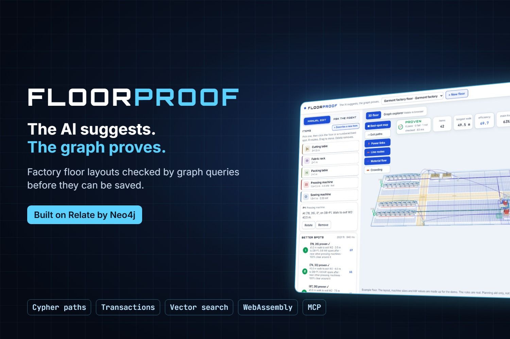](https://youtu.be/KRodMOtMFvU)

**▶ Demo video (2 min): https://youtu.be/KRodMOtMFvU**

> **Planning aid only.** FloorProof is not a certified safety tool. It does not replace a fire officer, a licensed
> electrician or a certified engineer. The example floors are made up. The rule numbers come from real sources
> (listed at the end), and a few are still marked TBD.

## Use case

Moving one machine on a factory floor can cause problems you don't see right away:

- it can block the only path someone has to an **exit**;
- it can squeeze an **aisle** below the legal width;
- it can overload a **power** drop box, or the panel above it, or the main breaker above that;
- it can make work on a **production line** go backwards.

All of these are questions about **how things connect**: who can walk where, what is plugged into what, and what
feeds what. A graph answers them directly.

AI models are good at suggesting layouts, but they don't reliably check these connections. In our tests, the model
on its own broke a safety rule in **5 of 30** requests. FloorProof lets the model suggest and the graph decide.
With the graph checks in the loop, **29 of 30** final layouts were proven. The last one was correctly handed back,
because the power tree had no room left.

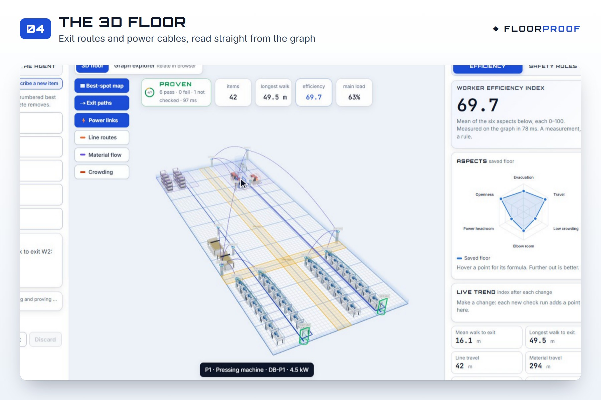

What you can do:

- **Edit the floor by hand in 3D.** Every change is checked straight away. If a rule breaks, the cells turn red and
  the rule says why. You can only save a layout when every check passes.
- **See the best spots for a machine.** Each suggested spot is proven by all the checks before you see it.
- **Ask the AI agent** in plain words, for example "Add 4 pressing machines to Line B". It proposes layouts, the
  graph checks them, and it tries again with the reasons when one fails.
- **Measure worker efficiency**: walking distance, material flow, crowding and elbow room.
- **Draw your own floor** for any industry, or describe a new machine in words. The same checks run on it.
- **Explore the graph** with Cypher, right inside your browser.

| A broken rule turns red | Best spots, each one proven |
| --- | --- |
| 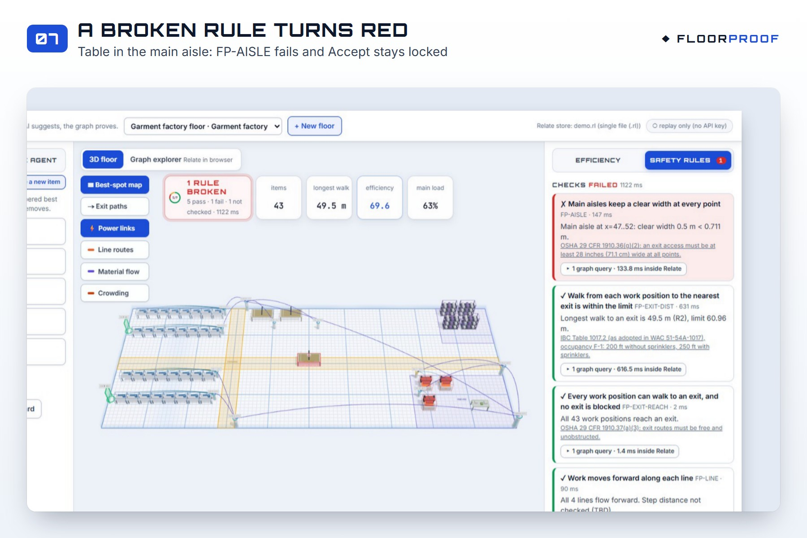 | 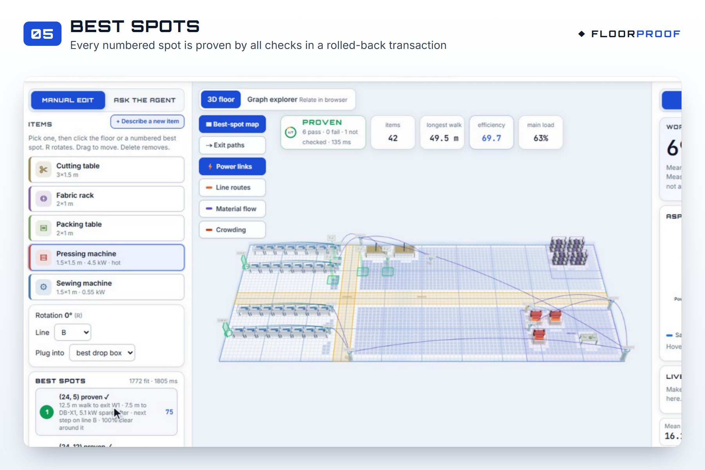 |
| **The AI agent proposes, the graph decides** | **Worker efficiency, measured on the graph** |
| 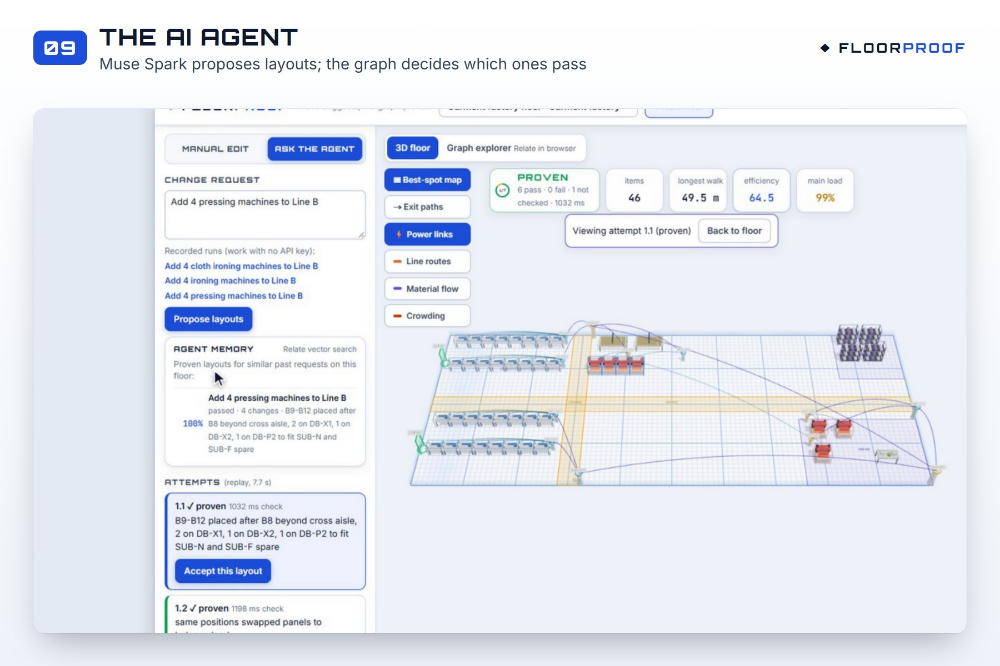 | 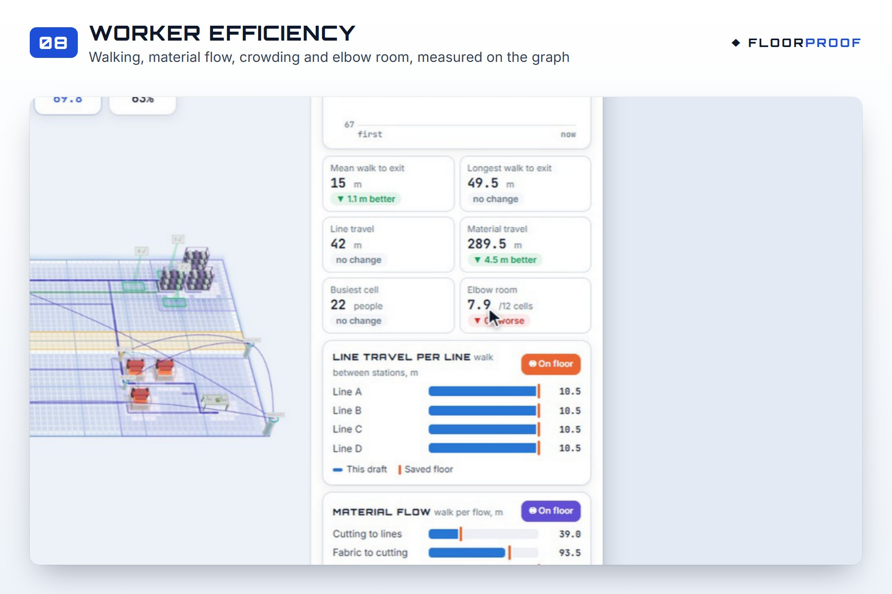 |

## How it uses Relate

- **Mode: single file.** The whole graph is one file, [`floorproof.rl`](floorproof.rl), in this repo.
- **Why this mode:**
  - A floor plan is something you hand to someone else. One file is easy to share, copy and look inside.
  - The data stays after the app stops, unlike in-memory mode, so you can open the same graph the app used.
  - It's simpler than a directory store for a graph this size (about 9,000 nodes).
  - Relate runs inside the Python app (`relate.connect("floorproof.rl")`), so there's no database server to set up.
- **What the graph models:**
  - **The floor:** a grid of 0.5 m `Cell` nodes. Cells you can walk between are linked by `ADJACENT`. When a
    machine is placed, its cells lose those links. So "can this worker reach an exit?" is simply a
    `shortestPath` over `ADJACENT` from the machine's work cell to an `Exit`.
  - **Power:** each machine is `POWERED_BY` a drop box, which is `FED_BY` a sub-panel, which is `FED_BY` the main
    breaker. One query adds up the load at every level.
  - **Production lines:** machines are linked in order by `FEEDS`.
  - **The rules themselves** are nodes (`RulePack`, `Rule`) with their numbers and source links. Adding the
    warehouse floor needed new data only, no new code.
  - **History:** every proposal and every check result is saved, with links to the rules it broke and the cells
    where it broke them.

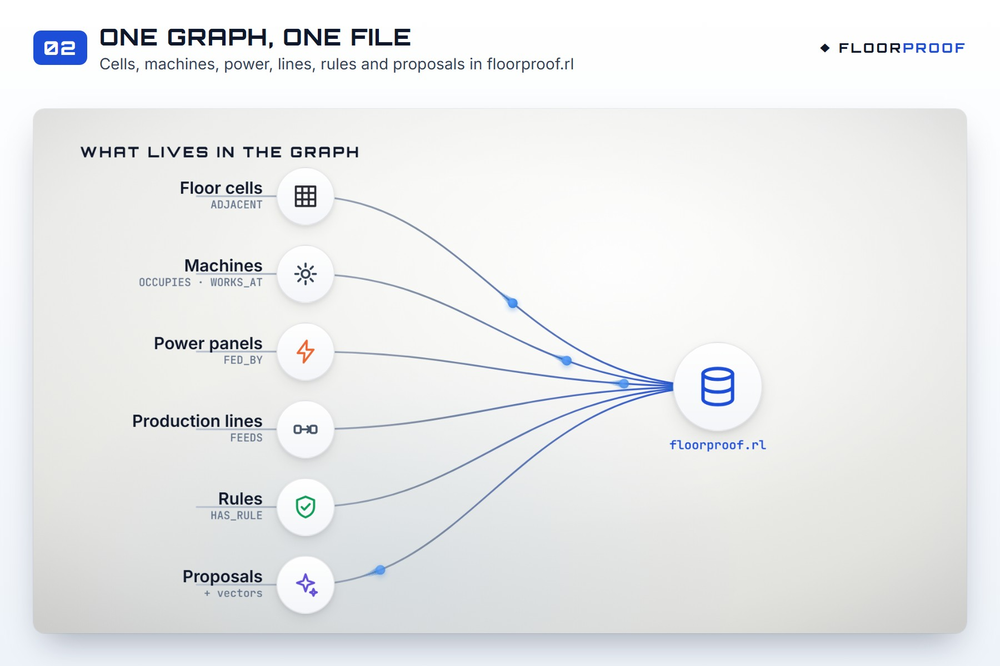

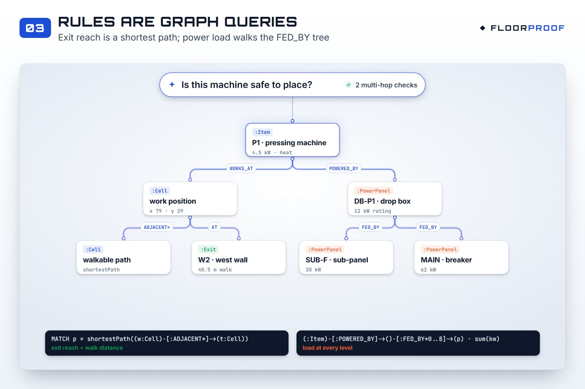

The Relate features we use, and what for:

| Relate feature | What FloorProof does with it |
| --- | --- |
| Cypher path queries | Exit reach and walking distance (`shortestPath`), power load up the tree (`FED_BY*0..8`), line order (`FEEDS`) |
| Transactions | Every draft is written in a transaction, checked, then **rolled back**, so the saved floor never changes by accident. Saving checks again inside the transaction and commits only if everything passes. |
| Vector search | Agent memory. Each proposal stores a vector of its request, and the agent recalls proven layouts from similar past requests. |
| WebAssembly | The Graph explorer loads the whole floor graph into Relate inside your browser tab. Queries run there, with no server. |
| Agent-ready results | Each check shows its Cypher and Relate's own timing. One of Relate's warnings helped us fix a slow query. |
| MCP + CLI | `relate serve --mcp` lets coding agents like Claude query the same file, read-only (see [`.mcp.json`](.mcp.json)). |
| Agent skill | Relate's skill is in [`.claude/skills/relate`](.claude/skills/relate), so coding agents that open this repo know how to use Relate. |

| Graph explorer (Relate in WebAssembly) | One graph, many ways in |
| --- | --- |
| 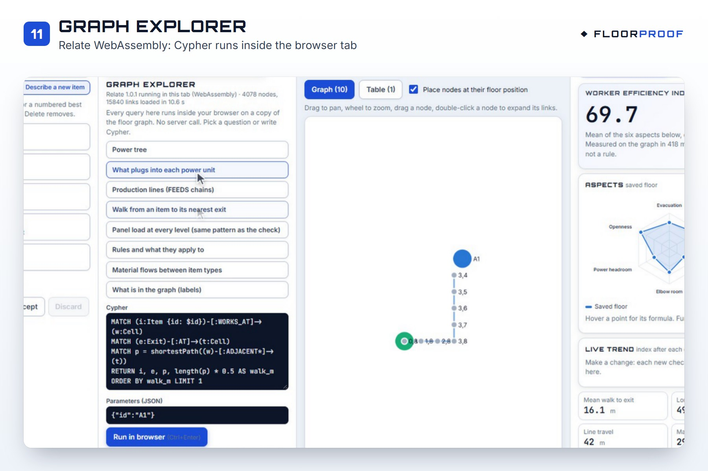 | 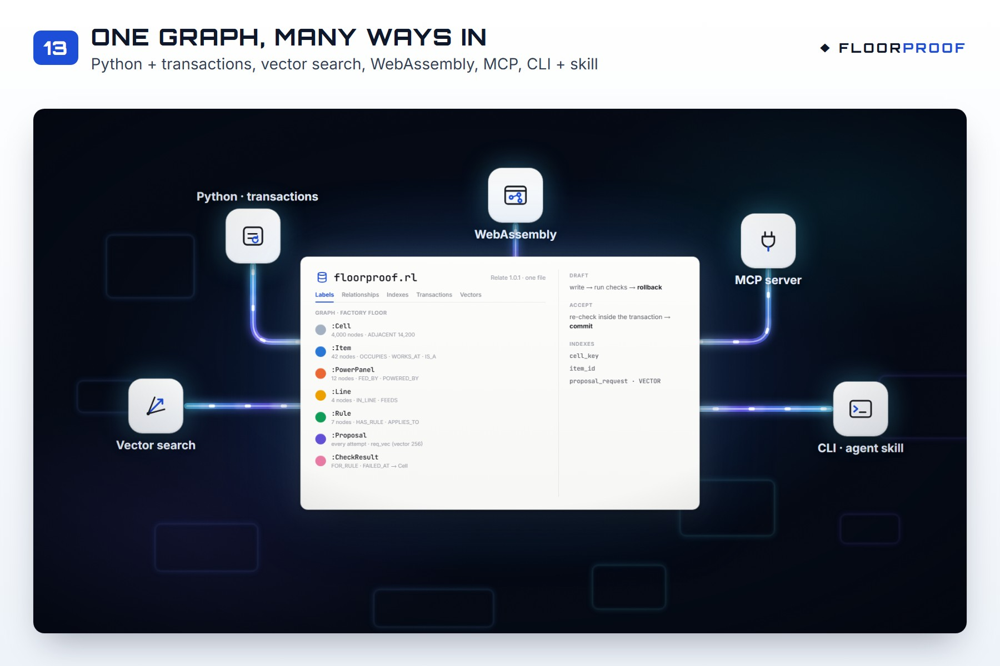 |

We did not use Bolt or HTTP serving, or Neo4j pull/push, because they need a Neo4j server this project doesn't have.

<details>
<summary><b>Everything that connects to what</b></summary>

```
(Floor)-[:USES_PACK]->(RulePack)-[:HAS_RULE]->(Rule)-[:APPLIES_TO]->(ItemType)
(Cell)-[:NEIGHBOR]->(Cell)              the fixed grid
(Cell)-[:ADJACENT]->(Cell)              cells you can walk between, updated when items move
(Cell)-[:IN_ZONE]->(Zone)               aisles, fabric store, staging ...
(Exit)-[:AT]->(Cell)   (PowerPanel)-[:AT]->(Cell)
(Item)-[:OCCUPIES]->(Cell)   (Item)-[:WORKS_AT]->(Cell)   (Item)-[:IS_A]->(ItemType)
(Item)-[:POWERED_BY]->(PowerPanel)-[:FED_BY]->(PowerPanel)-[:FED_BY]->(PowerPanel)
(Item)-[:IN_LINE {seq}]->(Line)   (Item)-[:FEEDS]->(Item)
(ItemType)-[:FLOWS_TO]->(ItemType)      material flow, for the efficiency numbers
(ItemType)-[:MUST_BE_FAR_FROM {min_m}]->(ItemType)
(Proposal)-[:PLACES]->(Item)   (Proposal)-[:HAS_RESULT]->(CheckResult)-[:FOR_RULE]->(Rule)
(CheckResult)-[:FAILED_AT]->(Cell)      the red cells in the 3D view
```
</details>

## Setup and run

**You need:** Python 3.12 or newer, and Node 18 or newer. **No API key is needed.** Without a key, the AI agent
replays answers we recorded from a real run, and the graph checks still run for real.

**Windows (PowerShell):**

```powershell
git clone https://github.com/Bin4yi/floorPoof.git
cd floorPoof
python -m venv .venv
.\.venv\Scripts\python -m pip install -r requirements.txt
.\scripts\run.ps1
```

**macOS / Linux:**

```bash
git clone https://github.com/Bin4yi/floorPoof.git && cd floorPoof
python3 -m venv .venv && .venv/bin/pip install -r requirements.txt
(cd frontend && npm install && npm run build)
.venv/bin/python -m uvicorn backend.api.app:app --port 8000
```

Open **http://localhost:8000**. Your first result in under a minute:

1. You'll see the factory floor, and the status bar says **PROVEN**.
2. Click **Pressing machine** on the left, and set **Line** to **B**.
3. Numbered spots appear on the floor. Press **1** to place the machine in the best proven spot.
4. Or open **Ask the agent** and click one of the recorded requests.

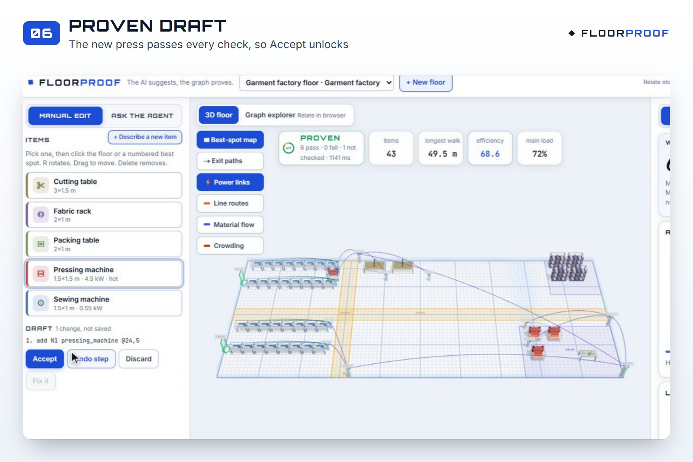

**If Windows blocks Relate** with `DLL load failed ... An Application Control policy has blocked this file`, Smart
App Control is blocking Relate's unsigned DLL. Use WSL2 instead. `scripts\py.ps1` switches to WSL by itself:

```powershell
wsl -d Ubuntu -u root -- apt-get install -y python3-venv python3-pip
wsl -d Ubuntu -- bash -lc "python3 -m venv ~/.venvs/floorproof && ~/.venvs/floorproof/bin/pip install -r requirements.txt"
.\scripts\run.ps1
```

**To use the live AI model** (optional): the agent uses Meta's Muse Spark (`muse-spark-1.1`). Put your key in a
`.env` file in the repo root as `META_API_KEY=...`.

Other commands:

```powershell
.\scripts\py.ps1 scripts/seed.py                      # rebuild floorproof.rl from backend/packs/*.json
.\scripts\py.ps1 -m pytest -q tests                   # tests, including 30 planted-bug layouts
.\scripts\py.ps1 scripts/reproduce.py --mode replay   # prints the test numbers below
```

## Where the data lives

- **The graph store: [`floorproof.rl`](floorproof.rl)**, in the repo root. It's one Relate file holding the
  factory floor, the warehouse floor, the rules, and every saved proposal.
- It's built from [`backend/packs/factory.json`](backend/packs/factory.json) and
  [`backend/packs/warehouse.json`](backend/packs/warehouse.json). `scripts/seed.py` rebuilds it from those.
- Floors and machines you create in the app are added to the store, and also saved in `backend/packs/custom/`.

**Look inside it yourself.** Stop the app first, because only one program can write to a `.rl` file at a time.

With Python:

```python
import relate
with relate.connect("floorproof.rl", read_only=True) as conn:
    cur = conn.cursor()
    cur.execute("""MATCH (i:Item {floor:'factory'})-[:POWERED_BY]->(:PowerPanel)-[:FED_BY*0..8]->(p:PowerPanel)
                   MATCH (i)-[:IS_A]->(t:ItemType)
                   RETURN p.name AS unit, sum(t.kw) AS kw, p.capacity_kw AS rating ORDER BY unit""", {})
    print(cur.fetchall())
```

With the Relate CLI ([install](https://relatedb.ai/docs/get-started/install/)):

```powershell
relate query --database .\floorproof.rl --read-only "MATCH (n) RETURN labels(n)[0] AS label, count(*) AS n ORDER BY n DESC"
```

Or from a coding agent over MCP: [`.mcp.json`](.mcp.json) starts `relate serve --mcp stdio --read-only` on the
store. It runs the Linux CLI in WSL, because Windows blocks the unsigned `relate.exe` on some machines.

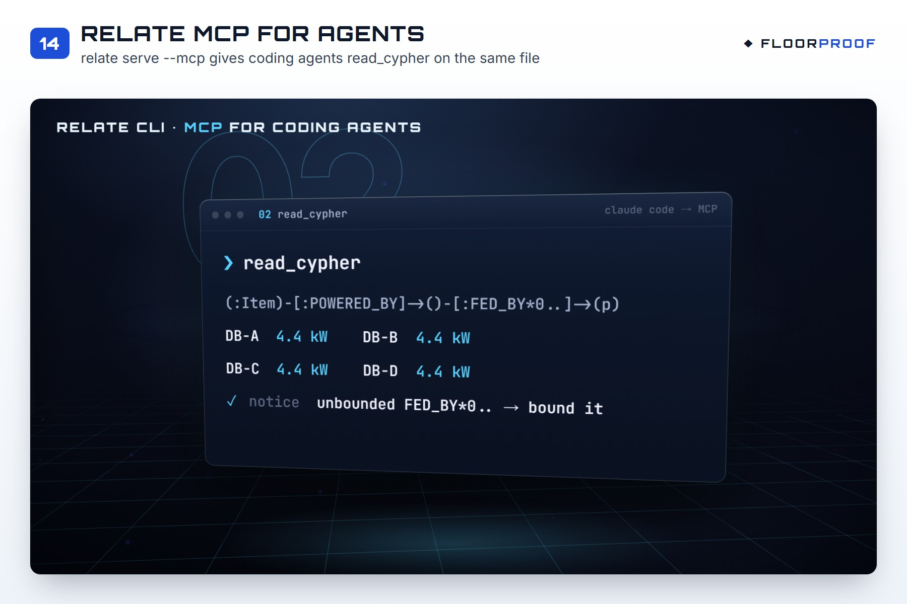

---

## Test numbers

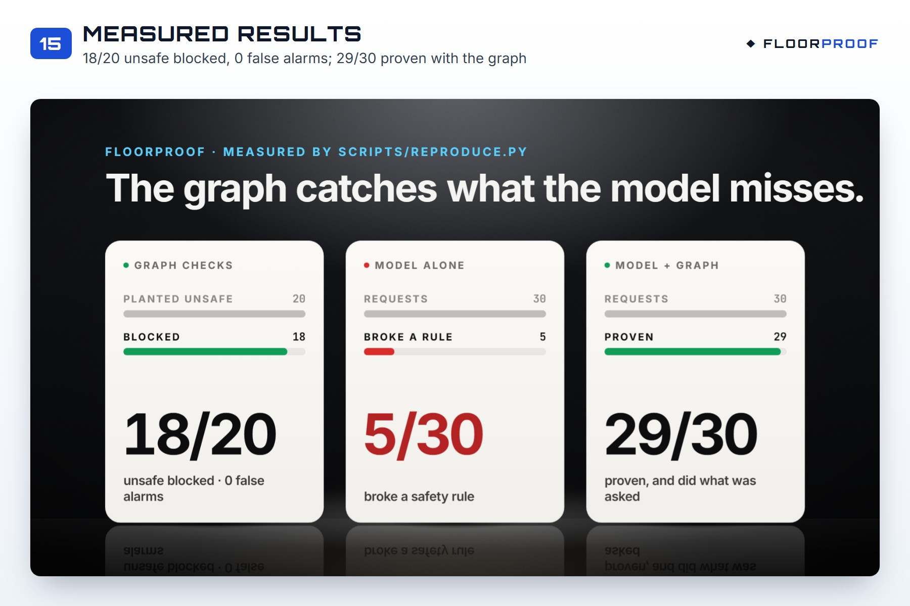

This is the output of `scripts/reproduce.py --mode replay`. It replays a recorded live run of `muse-spark-1.1`,
and the graph checks run again for real. Full output, one line per request:
[docs/reproduce-output.txt](docs/reproduce-output.txt).

```text
Part 1: planted-bug layouts
  unsafe layouts blocked: 18 of 20, safe layouts wrongly blocked: 0 of 10
  not counted as blocked, rule number TBD: 2 (u16_sep_press_by_racks, u17_sep_press_moved)
  check time per layout: mean 368 ms, max 505 ms

Part 2: change requests through the full loop
  requests run: 30 of 30 (model answers: replay)
  passed on the first round: 26, passed after retries: 3, never solved: 1
  average check time per layout: 311 ms over 81 layouts
  NEVER r15_factory "Add 5 pressing machines anywhere on the floor": handed back to the user with the open problems: FP-PANEL: sub panel SUB-N 26.8 kW > limit 24.0 kW; main breaker MAIN 53.6 kW > limit 49.6 kW.

Part 3: model alone against model plus checks (same requests)
  model alone: 5 of 30 first layouts broke a rule (or were unusable)
  BROKE r01_factory "Add 4 pressing machines to Line B": FP-PANEL
  BROKE r07_factory "Add 2 more fabric racks in the fabric store": FP-EXIT-REACH
  BROKE r15_factory "Add 5 pressing machines anywhere on the floor": FP-EXIT-REACH, FP-PANEL
  BROKE r21_warehouse "Add 2 pallet racks in the empty area east of the east forklift aisle": WH-EXIT-REACH
  BROKE r27_warehouse "Add 3 flammable liquid pallets to the hazmat staging area": WH-EXIT-REACH
  model plus checks: 29 of 30 final layouts proven by the graph checks, 29 of 30 proven and doing what was asked; the rest handed back to the user
  every layout shown by model plus checks passed the checks; unchecked, the model alone would have shown 5 rule-breaking layouts

```

In plain words:

- **Part 1 needs no AI.** We hid one mistake in each of 20 unsafe layouts, and the checks caught 18. The other 2
  break the separation rule, whose distance has no source yet, so we don't count them as caught. None of the 10
  safe layouts were wrongly blocked.
- **Part 2:** request r15 asks for 5 pressing machines, but the power tree only has room for 4. Handing it back is
  the right answer.
- **Part 3** counts a layout as broken if it fails any check or can't be used. The model alone gets no feedback.

## Rules and their sources

| Rule | Number used | Source |
| --- | --- | --- |
| Exit reach (both floors) | No number. Every work position must reach an exit, and no exit may be blocked. | [OSHA 29 CFR 1910.37(a)(3)](https://www.osha.gov/laws-regs/regulations/standardnumber/1910/1910.37): "Exit routes must be free and unobstructed." |
| Exit distance (factory) | 60.96 m (200 ft) without sprinklers, 76.2 m (250 ft) with | [IBC Table 1017.2, occupancy F-1, as adopted in WAC 51-54A-1017](https://lawfilesext.leg.wa.gov/Law/WACArchive/2024/htm/WAC%20%2051%20-%2054A%20CHAPTER/WAC%20%2051%20-%2054A-1017.htm) |
| Aisle width (main aisles, warehouse walking aisle) | 0.711 m (28 in) clear | [OSHA 29 CFR 1910.36(g)(2)](https://www.osha.gov/laws-regs/regulations/standardnumber/1910/1910.36): "An exit access must be at least 28 inches (71.1 cm) wide at all points." |
| Panel load (factory) | Continuous load at most 80% of rating, at every level | NEC 210.20(A), quoted in [IAEI Magazine](https://iaeimagazine.org/2016/may2016/100-vs-80-choosing-the-right-ocpd-solution/). All machines are treated as continuous (3 h or more). |
| Line flow (factory) | No number. Each step sits further along the line than the last. | Process rule. Maximum distance between steps: **TBD** |
| Separation, pressing machine to fabric rack | **TBD** | No source yet |
| Forklift aisle width (warehouse) | **TBD** | [OSHA 29 CFR 1910.176(a)](https://www.osha.gov/laws-regs/regulations/standardnumber/1910/1910.176) asks for "sufficient safe clearances" but gives no number |
| Separation, oxidizer to flammable liquid pallets | **TBD** | No source yet |
| No overlap (both floors) | No number | Physical constraint |

A rule with a TBD number shows as "not checked" in the app, and is never counted as a pass. To fill one in, edit the
pack JSON and run `scripts/seed.py`.

**Limits:**
- Walking paths move in 0.5 m steps, so measured walks are never shorter than real ones.
- Power is counted in kW, not amps.
- The codes are US codes (OSHA, IBC, NEC), and local codes may differ.

## More screenshots

| | |
| --- | --- |
| 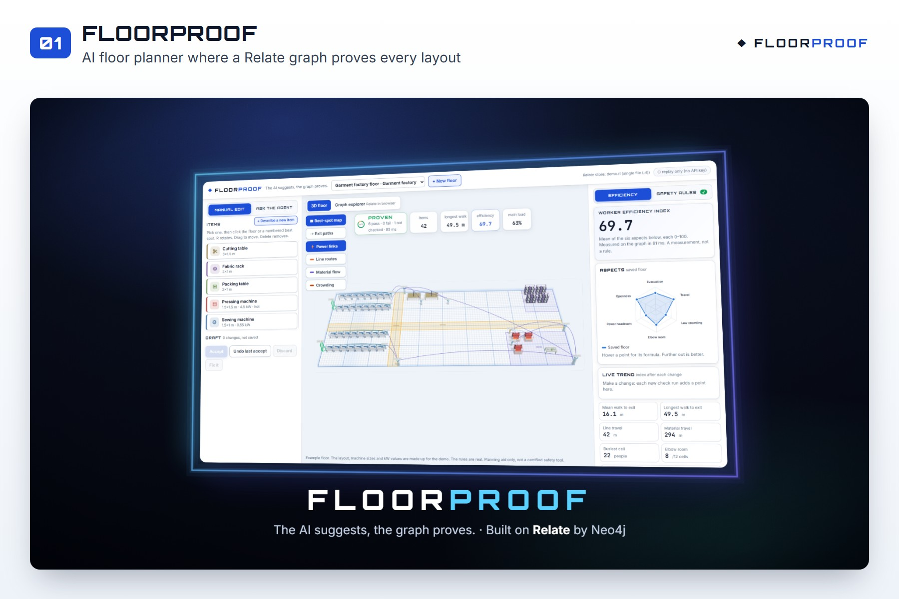 | 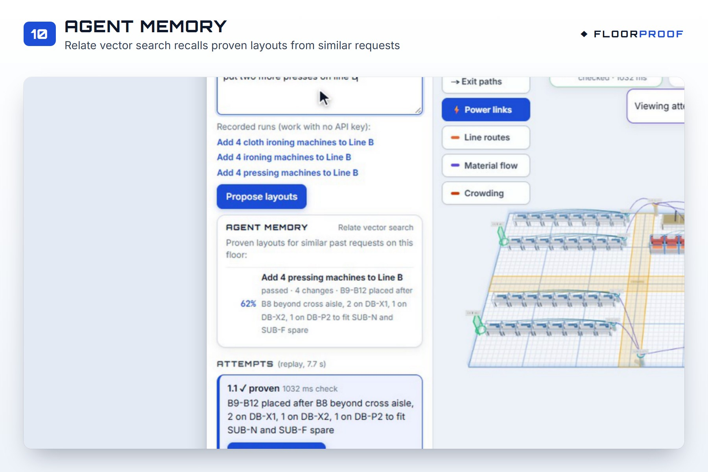 |
| 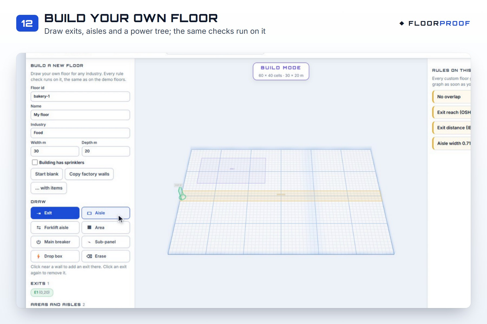 |  |

## More detail

- **Code map:**
  - `backend/graph`: Relate wrapper, schema, seeding and custom floors
  - `backend/checks`: one file per rule
  - `backend/engine.py`: draft, accept and undo
  - `backend/agent`: the agent loop (LangGraph), the Meta model client, and replay
  - `backend/suggest.py`: best spots
  - `backend/metrics.py`: worker efficiency
  - `backend/memory.py`: vector-search memory
  - `backend/api`: the web API (FastAPI)
  - `frontend`: React, TypeScript and React Three Fiber. The 3D models are built from simple shapes in code, with no model files.
- **Notes from testing Relate**, including timings, a bug we found and how we worked around it, and a 20x faster
  seeding trick: [docs/relate-notes.md](docs/relate-notes.md).
- **Demo video source:** [`video/`](video), made with Remotion. The app clips in it are real screen recordings.
